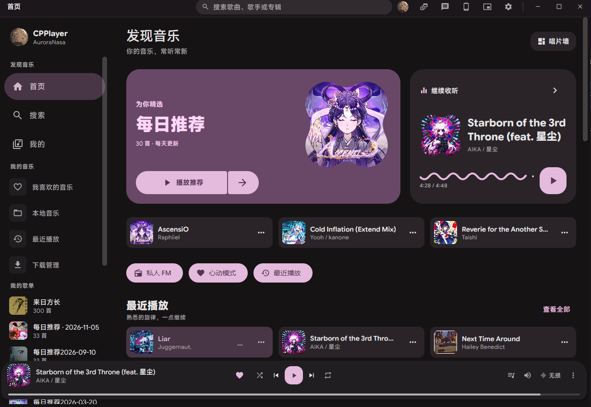
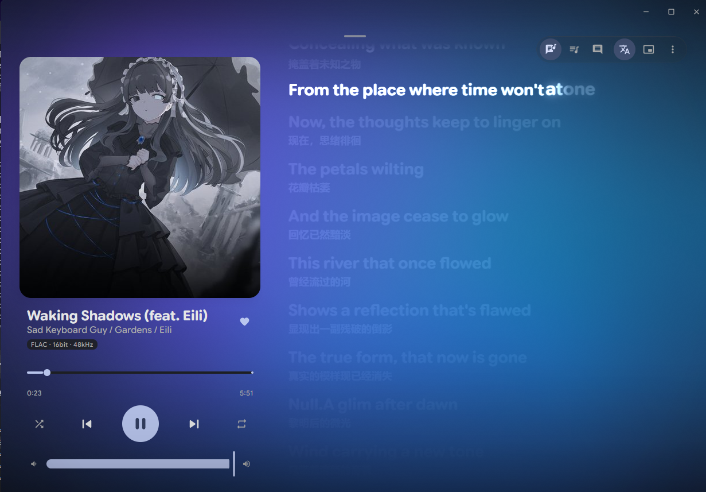
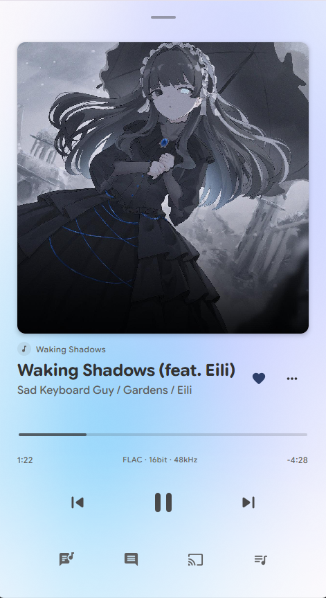

# CPPlayer

### 基于 Kotlin Multiplatform 的跨平台音乐播放器

---

桌面端主界面。当前文件为界面示意图。

CPPlayer 是一款支持 Android、Windows、macOS 和 Linux 的音乐播放器。应用通过音源插件提供在线内容，包含播放控制、歌词、音效、下载缓存及设备间播放接力等功能。

---

## 界面示例

<table>
  <tr>
    <td align="center" width="34%">
      
       桌面端播放界面与逐字歌词
    </td>
    <td align="center" width="30%">
      
       移动端播放界面
    </td>
  </tr>
</table>

## 功能

| 功能 | 说明 |
|---|---|
| **平台** | Android、Windows、macOS 和 Linux。桌面端支持原生窗口操作与全局快捷键。 |
| **音频播放** | 桌面端支持 WASAPI Exclusive 独占输出与 DSD 解码；播放过的无损音频可缓存到本地。 |
| **音效** | 10 频段参数均衡器、预设、声道平衡、响度归一化和削顶保护。 |
| **歌词** | 支持逐字歌词、本地 `.lrc` / `.ttml` 文件、AMLL 词库及 Lyrico 歌词插件，可设置来源优先级。 |
| **音源插件** | 在线内容由插件提供。登录会话按音源和账号隔离。 |
| **设备间播放** | 同一 Wi-Fi 网络内可发现设备并转移播放进度、同步听歌记录；也可向支持的外部接收端推送音频流。 |

---

## 开始使用

| 步骤 | 做什么 |
|---|---|
| 1 · 安装 | 从 Release 页下载对应平台的安装包：Windows 安装版或免安装版、macOS `.dmg`、Linux `.deb` 或 `.tar.gz`、Android APK。应用会检查更新并提示可用版本。 |
| 2 · 导入音源 | 首次启动时在引导页选择「导入音源模块」，或进入「设置 → 音源管理」并点击右上角「+」导入 `.zip` / `.cpm` 音源包。首个导入的音源会自动激活。 |
| 3 · 搜索与播放 | 搜索歌曲后可直接播放或加入队列。点击底部播放条打开全屏播放器。 |

完整说明见 [用户指南](docs/USER_GUIDE.md)。

## 音源说明

CPPlayer 不包含受版权保护的在线音源，在线内容由插件提供。可搜索的内容、可登录的账号及扩展功能取决于已导入的音源。界面显示「不支持」时，表示当前音源未声明或未实现对应能力。

---

<b>面向开发者</b>

 

CPPlayer 使用 Kotlin Multiplatform 与 Compose Multiplatform。`provider-sdk-kmp` 定义 Provider 契约，包含 164 个业务操作。宿主通过 `MusicBackend` 访问后端；Kotlin、JavaScript、JNI 和 C ABI 适配器使用同一组类型化操作。音源需实现 `search`、`get` 和 `resolve` 等基础操作；DRM 可通过 `resolveDrm` 与 `exchangeLicense` 接入。

| 模块 | 职责 |
|---|---|
| `provider-sdk-kmp` | Provider 契约、数据类型与受控 runtime；不依赖 UI 或具体音源 |
| `core` | 会话、统一数据层、播放内核、本地库、下载与流输出；无 UI 代码 |
| `app` | Compose UI、导航、主题与桌面入口 |
| `app-android` | 平台入口与 Media3 `MediaSessionService` |

| 想做的事 | 从这里开始 |
|---|---|
| 跑起来 | `./gradlew :app:run`（桌面端）· `./gradlew :app-android:assembleDebug`（Android） |
| 写一个音源 | [Provider 快速上手](docs/dev/providers/QUICKSTART.md) |
| 看架构与边界 | [ARCHITECTURE](docs/dev/ARCHITECTURE.md) |
| 构建、测试与发布 | [BUILD](docs/dev/BUILD.md) · [RELEASE](docs/dev/RELEASE.md) |
| 把播放器接进游戏 / 车载 | [对外集成 API](docs/dev/INTEGRATION_API.md) |
| 全部文档 | [文档索引](docs/index.md) · [在线文档站](https://aurora-nasa-1.github.io/CPPlayer-KMP/) |
| 参与贡献 | [贡献指南](CONTRIBUTING.md) |

---

## 赞助与支持

如需赞助，可使用下方收款码。备注 GitHub 账号或昵称便于识别。

| 微信支付 | 支付宝 |
| :---: | :---: |
|  |  |
| 收款人：Aurora星空 (\*\*森) | 收款人：Aurora星空 (\*\*森) |

## 致谢

Hi-Res 音频内核（FlickEngine / WASAPI 独占直通 / DSD 解码）的设计与底层实现参考开源项目 [Flick](https://github.com/moss-apps/Flick)。

| 对象 | 关系 |
|---|---|
| [moss-apps](https://github.com/moss-apps) | 跨平台音频解码管线与低延迟推流（MIT） |
| [Rodio](https://github.com/RustAudio/rodio) | 音频输出 |
| [Symphonia](https://github.com/pdeljanov/Symphonia) | 解码 |
| [cpal](https://github.com/RustAudio/cpal) | 设备与独占模式 |
| [Lyrico](https://github.com/Replica0110/Lyrico) | 歌词插件 API |
| [Nucleus](https://github.com/NucleusFramework/Nucleus) | 桌面端无 AWT 窗口、原生系统托盘与 GraalVM Native Image 运行时 |

完整清单见 [NOTICE](NOTICE) 与 [THIRD_PARTY_LICENSES.md](THIRD_PARTY_LICENSES.md)。

## 许可证

[Apache License 2.0](LICENSE)。
